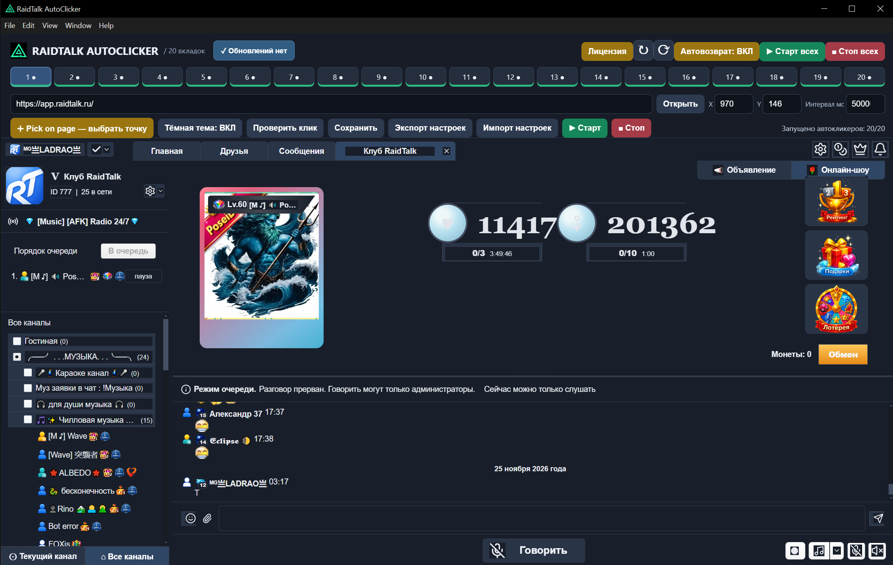
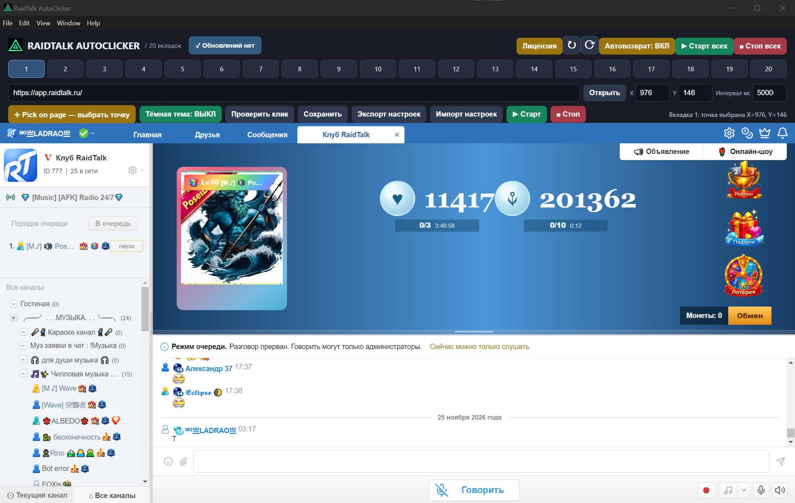

<div align="center">


<table>
<tr>
<td align="center" width="50%"><strong>Dark Theme</strong></td>
<td align="center" width="50%"><strong>Original Theme</strong></td>
</tr>
<tr>
<td width="50%"></td>
<td width="50%"></td>
</tr>
</table>

# RaidTalk AutoClicker

**Windows desktop workspace for RaidTalk with 20 browser tabs, independent auto-clickers, theme switching and automatic page-effect reduction.**

[](https://github.com/vertuozi92/RaidTalk-AutoClicker/releases/latest)
[](https://github.com/vertuozi92/RaidTalk-AutoClicker/releases)
[](https://github.com/vertuozi92/RaidTalk-AutoClicker/releases/latest)

[Download for Windows](https://github.com/vertuozi92/RaidTalk-AutoClicker/releases/latest) · [Report a problem](https://github.com/vertuozi92/RaidTalk-AutoClicker/issues)

</div>

---

## Overview

RaidTalk AutoClicker is an Electron desktop application that opens RaidTalk in a workspace of 20 tabs. Every tab has its own click position, interval and controls. The app combines automated clicking with a customizable viewing experience.

## Features

### Browser workspace
- **20 browser tabs** with independent settings
- **Per-tab auto-clicker** with configurable screen coordinates and click interval
- **Pick on page** to select the click position directly on the page
- **Visual click indicator** to make click activity easier to see
- **Refresh controls** for the current tab and all tabs
- **Auto-rejoin** option for returning to the selected RaidTalk group when the connection or session is interrupted

### Appearance and performance
- **Dark theme switch** — switch RaidTalk between the dark appearance and its original website theme
- **Animations and visual effects disabled automatically** — the reduced-effects mode stays enabled; there is no separate effects toggle
- The selected theme is applied across the browser tabs

### Settings and licensing
- **Local settings storage** between application sessions
- **JSON export and import** for settings across all 20 tabs
- **License and account window** with trial/status information
- **Windows installer** built with electron-builder (NSIS)

## Download and install

1. Open the [latest release](https://github.com/vertuozi92/RaidTalk-AutoClicker/releases/latest).
2. Download the installer attached to the latest release.
3. Run the installer and follow the setup steps.
4. Launch **RaidTalk AutoClicker** from the Start menu or desktop shortcut.

**System:** Windows 10/11, 64-bit. An internet connection is required to load RaidTalk and use online account/license features.

## Run from source

Install a current Node.js LTS release, then run these commands in the project folder:

```bash
npm install
npm start
```

## Build the Windows installer

```bash
npm install
npm run dist
```

The NSIS installer is generated in the `release` folder.

You can also run `BUILD_INSTALLER.bat` on Windows.

## Project structure

```text
src/
  main.js       Electron main process
  preload.js    Secure renderer bridge
  index.html    Application interface
  renderer.js   Tabs, theme, settings and clicker interface
package.json    Dependencies and build configuration
```

## Usage notes

- Choose a tab, set its click position and interval, then start or stop that tab's clicker.
- Use the point picker only on a page area where clicking will not submit, purchase, delete, send, or otherwise trigger an unintended action.
- The computer and application must remain running for background activity; a powered-off or sleeping computer cannot perform clicks.
- Use the app only with accounts and pages you are authorized to access. It does not grant access to restricted groups or content.
- Automatic group rejoin depends on RaidTalk availability and the current account/session state.

## Troubleshooting

- If the app does not start from source, check that Node.js LTS is installed and run `npm install` again.
- If installer creation fails, run `BUILD_INSTALLER.bat` from the project folder and review the final error shown in the console.
- For bugs or feature requests, [open a GitHub issue](https://github.com/vertuozi92/RaidTalk-AutoClicker/issues).

## Language

Russian quick-start notes are available in [README_RU.txt](README_RU.txt).

## License

This repository is currently marked **UNLICENSED**. All rights are reserved by the repository owner unless a separate license is added.
