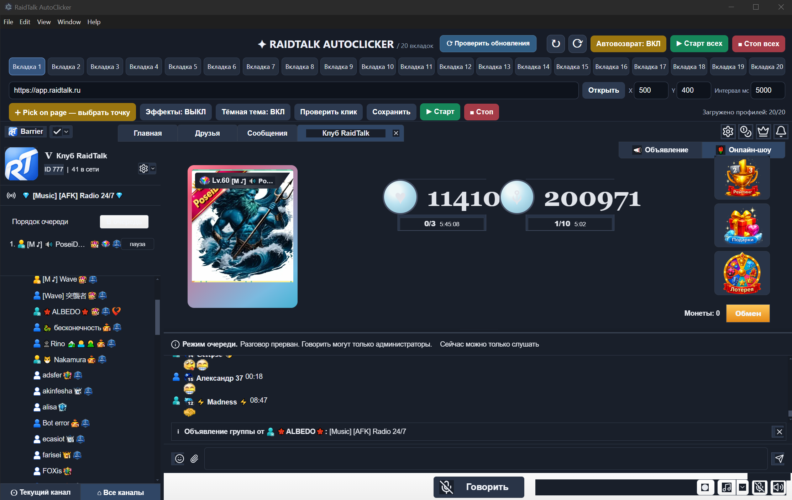

<div align="center">




# RaidTalk AutoClicker

**Windows desktop workspace for RaidTalk with 20 browser tabs and per-tab auto-click settings.**

[](https://github.com/vertuozi92/RaidTalk-AutoClicker/releases/latest)
[](https://github.com/vertuozi92/RaidTalk-AutoClicker/releases)
[](https://github.com/vertuozi92/RaidTalk-AutoClicker/releases/latest)

[Download for Windows](https://github.com/vertuozi92/RaidTalk-AutoClicker/releases/latest) · [Report a problem](https://github.com/vertuozi92/RaidTalk-AutoClicker/issues)

</div>

---

## Overview

RaidTalk AutoClicker is an Electron desktop application that opens RaidTalk in a workspace of 20 tabs. Each tab has its own click coordinates and interval settings.

## Features

- **20 browser tabs** with independent per-tab settings
- **Per-tab auto-clicker** with configurable coordinates and interval
- **Page point picker** to select a click position
- **Visual click indicator** to make click activity easier to see
- **Dark page styling** and reduced page animations
- **Tab controls** to refresh the current tab or all tabs
- **Local settings storage** between application sessions
- **JSON backup and restore** for settings across all 20 tabs
- **Windows installer** built with electron-builder (NSIS)

## Download and install

1. Open the [latest release](https://github.com/vertuozi92/RaidTalk-AutoClicker/releases/latest).
2. Download the installer attached to the latest release.
3. Run the installer and follow the setup steps.
4. Launch **RaidTalk AutoClicker** from the Start menu or desktop shortcut.

**System:** Windows 10/11, 64-bit. An internet connection is required to load RaidTalk.

## Run from source

Install a current Node.js LTS release, then run these commands in the project folder:

```bash
npm install
npm start
```

## Build the Windows installer

```bash
npm install
npm run dist
```

The NSIS installer is generated in the `release` folder.

You can also run `BUILD_INSTALLER.bat` on Windows.

## Project structure

```text
src/
  main.js       Electron main process
  preload.js    Secure renderer bridge
  index.html    Application interface
  renderer.js   Tabs, settings and clicker interface
package.json    Dependencies and build configuration
```

## Usage notes

- Choose a tab, set its click position and interval, then start or stop that tab's clicker.
- Use the point picker only on a page area where clicking will not submit, purchase, delete, send, or otherwise trigger an unintended action.
- The computer and application must remain running for background activity; a powered-off or sleeping computer cannot perform clicks.
- Use the app only with accounts and pages you are authorized to access. It does not grant access to restricted groups or content.

## Troubleshooting

- If the app does not start from source, check that Node.js LTS is installed and run `npm install` again.
- If installer creation fails, run `BUILD_INSTALLER.bat` from the project folder and review the final error shown in the console.
- For bugs or feature requests, [open a GitHub issue](https://github.com/vertuozi92/RaidTalk-AutoClicker/issues).

## Language

Russian quick-start notes are available in [README_RU.txt](README_RU.txt).

## License

This repository is currently marked **UNLICENSED**. All rights are reserved by the repository owner unless a separate license is added.
